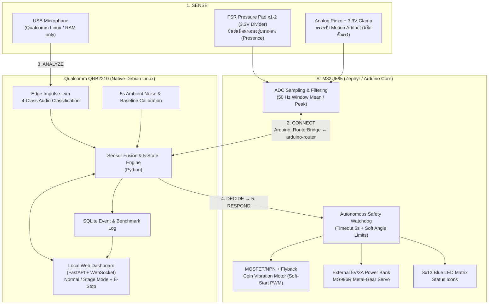
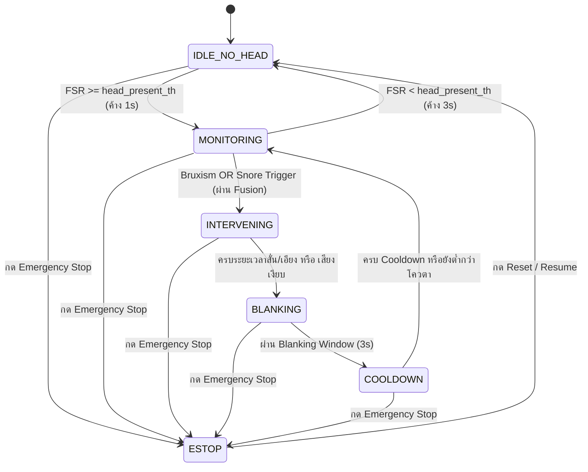

# Design Document — Silent Bruxism & Snore Interruptor (Smart Pillow v2: Stage-Ready Edition)

**วันที่:** 2026-11-20  
**กำหนดแข่งขัน:** 26–27 พฤศจิกายน 2026 (ระยะเวลาพัฒนาและทดสอบ 6 วัน)  
**แพลตฟอร์มเป้าหมาย:** Arduino UNO Q 4GB *(มีบอร์ดอยู่ในมือแล้ว — พัฒนาและทดสอบบนเครื่องจริงตั้งแต่ Day 1)*  
**เวทีเป้าหมาย:** Arduino UNO Q AIoT & Edge AI Hackathon — Health, Wellness and Smart Living (Arduino Education Day Thailand 2026)

---

## 1. Intent & The Why

เอกสารนี้ออกแบบการปรับปรุง **Smart Pillow** สำหรับหยุดอาการ **นอนกัดฟัน (Bruxism)** และ **นอนกรน (Snoring)** แบบไม่ปลุกให้ตื่น โดยยกระดับจากสเปกแนวคิดเดิมให้กลายเป็น **Working Prototype ที่สาธิตได้จริงและเสถียรบนเวที Hackathon ภายในเวลา 6 วัน**

การตัดสินใจออกแบบทุกข้อผูกตรงกับโครงสร้างคะแนนและกติกาของรายการ:
* **Technical Integration (25 คะแนน):** ใช้สถาปัตยกรรม 2 สมองของ Arduino UNO Q อย่างคุ้มค่า (Qualcomm Debian Linux รัน Edge AI + Decision Engine + Dashboard, STM32U585 อ่าน Analog 14-bit + ขับ PWM/Servo/LED Matrix + Watchdog) ผ่าน `Arduino_RouterBridge` / `arduino-router`
* **Functional Prototype & Testing (20 คะแนน):** สาธิตสดได้จริง เสถียร ไม่ค้างกลางเวที พร้อมหลักฐานการทดลอง (Confusion Matrix, อัตราการตัด False Alarm ก่อน–หลังเปิด Sensor Fusion, และเรื่องเล่าการปรับแก้ทางวิศวกรรมจริง เช่น การเปลี่ยนหน้าที่ Piezo และเพิ่ม FSR)
* **Impact, Feasibility & Safety (10 คะแนน):** ป้องกันไฟกระชาก ป้องกันขา ADC 3.3V พัง มีกลไกตัดมอเตอร์อัตโนมัติ (Watchdog) และอธิบายข้อจำกัดของต้นแบบ vs เวอร์ชันใช้งานจริง (Air Bladder) ได้อย่างตรงไปตรงมา
* **Problem & User Need (15) + Innovation (15) + Presentation (10) + Documentation (5):** รองรับรูปแบบ Pitch **7 นาที + Q&A 3 นาที** (เวลาเดโมสดจริงประมาณ 2–3 นาที) ในห้องจัดงานที่มีเสียงรบกวน

---

## 2. Goals, Non-Goals & Anti-Goals

### Goals
1. **Triple-Signal Sensor Fusion ที่สอดคล้องกับฟิสิกส์จริง:**
   * **FSR (Force Sensitive Resistor)** ทำหน้าที่ **Head Presence Sensor** ยืนยันว่า *"มีศีรษะวางอยู่บนหมอนจริง"* แม้คนนอนนิ่ง ๆ (แก้ข้อจำกัดเดิมที่คิดจะใช้ Piezo วัดการมีคนนอน)
   * **Analog Piezo** ปรับหน้าที่เป็น **Motion Artifact Detector** จับแรงสั่นกระชากตอนพลิกตัว/ขยับแรง ๆ เพื่อปฏิเสธเสียงผ้าเสียดสีปลอกหมอนไม่ให้หลอก AI ว่าเป็นเสียงกัดฟัน (เหมาะกับธรรมชาติของ Piezo ที่จับแรงกระแทกชั่วขณะได้ดีโดยไม่ต้องใช้วงจร Preamp ซับซ้อน)
   * **USB Microphone + Edge Impulse `.eim`** แยกเสียง 4 คลาสแบบออฟไลน์ 100% ใน RAM (ไม่บันทึกไฟล์เสียงลงดิสก์)
2. **Zero Self-Feedback Loop:** มี State Machine 5 สถานะ พร้อมช่วง `BLANKING` ตัดการตรวจจับระหว่างและหลังมอเตอร์/Servo ทำงาน ไม่ให้ระบบกระตุ้นตัวเองซ้ำ
3. **Hardware-Level Safety:** แยกแหล่งจ่ายไฟมอเตอร์ออกจากบอร์ด, ป้องกันแรงดันเกินบนขา Analog 3.3V, และมี Autonomous Watchdog บน STM32 ที่หยุดทุก Actuator เองเมื่อ Linux ค้างหรือ Bridge ขาดการติดต่อ
4. **Stage-Ready Live Demo:** มี **Stage Demo Mode** และปุ่ม **1-Click Ambient Calibration** บนหน้าเว็บ ทำให้เดโมครบ 3 เคส (`False Alarm` → `Bruxism` → `Snoring` + `Emergency Stop`) จบได้ภายใน ~90 วินาทีแม้ในห้องแข่งที่มีเสียงดัง
5. **Evidence for Judges:** ระบบบันทึก Log ลง SQLite และ Export ตาราง/กราฟผลการทดสอบ (CSV / Print PDF) เพื่อใช้เป็นหลักฐานในสไลด์ Pitch และเอกสาร Engineering Documentation

### Non-Goals
* **ไม่ใช่ผลิตภัณฑ์ทางการแพทย์ (Non-Medical Device):** ไม่ได้วินิจฉัยภาวะหยุดหายใจขณะหลับ (OSA) และไม่ได้ออกแบบให้ผ่านมาตรฐานเครื่องมือแพทย์
* **ไม่ได้ออกแบบให้ทนการนอนจริง 8 ชั่วโมงต่อคืน หรือรับน้ำหนักศีรษะจริง 4–5 กก. ในเวอร์ชัน 6 วันนี้:** ต้นแบบออกแบบสำหรับ **Tabletop Demo (ใช้มือกดหรือตุ้มน้ำหนักจำลอง ~0.5–1.5 กก.)** เพื่อให้เห็นกลไกชัดเจน ปลอดภัย และประกอบทันภายใน 6 วัน *(My Call — ดูรายละเอียดในหัวข้อ 6)*
* **ไม่เชื่อมต่อ Cloud:** ระบบทั้งหมดทำงานแบบ Local / Offline บนบอร์ด UNO Q เพื่อรักษาความเป็นส่วนตัวและกันปัญหา Wi-Fi ในงานแข่งล่ม

### Anti-Goals (ถือว่าล้มเหลวแม้โค้ดจะรันผ่าน)
* **บอร์ดรีเซ็ตหรือ Brownout** ระหว่างเดโมตอน Servo เริ่มหมุน
* **มอเตอร์สั่นหรือ Servo กวนเซ็นเซอร์ตัวเอง** จนระบบสั่งงานวนลูปไม่หยุด
* **False Trigger จากเสียงผู้ชม/ลำโพงในฮอลล์** ตอนที่ไม่มีแรงกดบนหมอน (FSR = 0)
* **โมเดล AI เพี้ยนหน้างาน** เพราะเทรนเสียงคนละโดเมนกับลำโพงที่ใช้เดโม หรือไม่มี Ambient Calibration
* **เดโมรอนานเกินไป** (ต้องยืนรอกรน 10+ วินาทีแล้วยังไม่ติดเพราะจังหวะหายใจเว้นช่อง 1–2 วิ ทำให้ตัวนับรีเซ็ต)

---

## 3. Constraints

1. **แพลตฟอร์มบังคับ:** Arduino UNO Q 4GB (มีบอร์ดอยู่ในมือแล้ว) ต้องสอดคล้องกับกรอบ `Sense → Connect → Analyze → Decide → Respond`
2. **ข้อจำกัดไฟฟ้าของ Arduino UNO Q (สำคัญมาก):**
   * ระดับลอจิกของ Header คือ **3.3V** (ไม่ใช่ 5V แบบ UNO R3)
   * ขา **A0, A1, และ D3 ไม่รองรับ 5V (Non-5V-Tolerant, max ~3.6V)** ส่วนขา Analog A0–A5 มีความละเอียด ADC 14-bit
3. **กรอบเวลาและสถานะของ:** เหลือเวลา **6 วัน (20–25 พ.ย.)** ก่อนวันแข่ง 26–27 พ.ย. — ยังไม่ได้จัดซื้ออุปกรณ์เสริมและยังไม่มี Audio Dataset ต้องเลือกของที่หาซื้อในไทยได้ทันที (วันเดียวถึง) และเก็บ Dataset ที่ตรงกับสภาพเดโมจริง
4. **เวลาการนำเสนอ:** Pitch 7 นาที + Q&A 3 นาที
5. **ความโปร่งใสและลิขสิทธิ์:** อุปกรณ์เสริม ซอฟต์แวร์ ไลบรารี ชุดข้อมูลเสียง (Dataset) และโมเดล AI ทั้งหมดต้องระบุแหล่งที่มาในเอกสาร Engineering Documentation

---

## 4. Approaches Considered

| แนวทาง | ภาพรวม | จุดเด่น | ข้อจำกัด / Trade-off |
| :--- | :--- | :--- | :--- |
| **A: Lean Demo-Proof** | คงเซ็นเซอร์เดิม (`Mic + Piezo`) เพิ่มแค่แยกไฟ Servo + Watchdog + State Machine/Demo Mode | งบต่ำสุด ทำเร็วสุด ตรงเอกสารเดิมเป๊ะ | Piezo วัดการมีหัวนอนนิ่ง ๆ ไม่ได้จริง เสี่ยงพังหน้างานและโดนจี้ตอน Q&A |
| **B: True Sensor Fusion & Stage-Ready *(ที่เลือก)*** | เพิ่ม **FSR** ทำหน้าที่วัดการมีคนนอน (Head Presence) แทน Piezo + ปรับ **Piezo** ไปจับ Motion Artifact ตอนพลิกตัว + **MG996R Metal-Gear Servo** แยกไฟ 5V/3A + วงจรกันไฟเกินขา ADC + State Machine 5 สถานะ + Stage Demo Mode & Benchmark Tools | ปิดทุกจุดอ่อนทางฟิสิกส์และความปลอดภัย ตอบคำถาม Q&A ได้ขาด เดโมเห็นภาพชัดและไวใน 90 วิ ประกอบทันใน 6 วัน กวาดคะแนน 55 แต้มหลักได้คุ้มสุด | ซื้ออุปกรณ์เพิ่ม 2–3 ชิ้น (FSR, Servo เฟืองเหล็ก, MOSFET, Power Bank 5V/3A) และต้องจูน Threshold เพิ่ม 1 ตัว |
| **C: Silent Air-Bladder Pillow** | เหมือนแนวทาง B แต่เปลี่ยน Servo เป็นถุงลม + Micro Air Pump 5V + Solenoid Valve | เหมือนสินค้าจริงมาก นุ่ม รับน้ำหนักหัวจริงได้สบาย คะแนน Innovation สูง | เสี่ยงลมรั่ว ปั๊มพองช้าเกินไปสำหรับ Pitch 7 นาที และเสี่ยงทำไม่ทันใน 6 วัน |

**เหตุผลที่เลือกแนวทาง B (การตัดสินใจของผู้ใช้):** บาลานซ์ที่สุดระหว่างความสมจริงทางวิศวกรรม ความเสถียรบนเวทีเดโม 7 นาที และความเร็วในการสร้างภายใน 6 วัน ส่วน **แนวทาง C (Air Bladder)** จะถูกวางเป็น **Future Work / Product Roadmap** ในสไลด์ Pitch เพื่อเสริมคะแนน Feasibility & Impact

---

## 5. System Design (Approach B)

### 5.1 ภาพรวมสถาปัตยกรรม (End-to-End Architecture)

---

### 5.2 Hardware BOM, Pinout & Electrical Safety

#### รายการอุปกรณ์หลัก (BOM — หาซื้อในไทยได้ทันทีสำหรับกรอบ 6 วัน)
* **Main Board:** Arduino UNO Q 4GB *(มีอยู่แล้ว)* + สาย/อะแดปเตอร์ USB-C 5V/3A
* **Sense (Audio):** USB Condenser/Omnidirectional Microphone แบบตั้งใกล้ขอบหมอน (ต่อเข้าฝั่ง Linux ผ่าน USB-C Hub)
* **Sense (Head Presence):** **FSR402** (หรือ FSR แถบยาว) 1–2 แผ่น วางใต้ปลอกหมอนบริเวณกลางหมอน (ต่อขนานเข้าตัวต้านทาน Pull-down `10 kΩ` เพื่อขยายพื้นที่รับแรงกด)
* **Sense (Motion Artifact):** Analog Piezo Disc (27–35 mm) 1 แผ่น วางใต้ปลอกหมอน + วงจรป้องกัน (`1 MΩ` bleed resistor + `3.3V Zener diode` ขนานขา Piezo) — ใช้จับแรงกระแทก/พลิกตัวแรง ๆ ซึ่งให้สัญญาณแรงพอโดยไม่ต้องเพิ่มวงจร Preamp
* **Respond (Bruxism):** Coin Vibration Motor (3V–5V) 1–2 ตัว ขับผ่าน **N-Channel MOSFET (IRLZ44N / 2N7000) หรือ NPN Transistor (S8050 / 2N2222)** + ไดโอดกันไฟย้อน (**1N4148 / 1N5819 Flyback Diode**) + ตัวต้านทาน Gate/Base (`1 kΩ`)
* **Respond (Snoring):** **MG996R Metal-Gear Servo** (~10 kg·cm ที่ 5–6V) ยึดกับฐานแผ่นแข็งบานพับใต้หมอนด้านข้างเพื่อยกมุมหมอนเอียงขึ้น 10°–25° สำหรับ Tabletop Demo *(หากต้องการรับน้ำหนักศีรษะคนจริง 4–5 กก. ให้เปลี่ยนเป็น `DS3218 20kg` + แหล่งจ่ายไฟ `6.8V–7.4V 3A`)*
* **Power Separation (บังคับเพื่อความปลอดภัย):** แหล่งจ่ายไฟแยก **5V ≥ 3A** (เช่น Power Bank 5V/3A หรือ Adapter 5V/3A + คาปาซิเตอร์กรองไฟ `470µF–1000µF` คร่อมรางไฟ Servo) ต่อ **GND ร่วม (Common Ground)** กับ Arduino UNO Q

#### การจัดขา (Pin Mapping — เคารพข้อจำกัด 3.3V ของ UNO Q) *(My Call: หลีกเลี่ยงขา A0, A1, D3 ที่ไม่รองรับ 5V)*
| สัญญาณ | ขา STM32 | หมายเหตุทางไฟฟ้า |
| :--- | :--- | :--- |
| FSR Analog Input | `A2` | ต่อวงจรแบ่งแรงดันจากขา **3.3V** ของบอร์ด (ห้ามใช้ 5V) เพื่อให้แรงดันเข้าไม่เกิน 3.3V |
| Piezo Analog Input | `A3` | ขนาน `1 MΩ` + `3.3V Zener` ป้องกัน Spike แรงดันสูงตอนกด/ตบหมอนแรง ๆ |
| Coin Motor PWM | `D5` (PWM) | ขับผ่าน MOSFET/Transistor + Flyback Diode เท่านั้น ห้ามต่อมอเตอร์ตรงเข้าขา MCU |
| Servo PWM Signal | `D9` (PWM) | ใช้ไฟเลี้ยง Servo จากราง 5V/3A แยก (ต่อเฉพาะสาย Signal + Common GND เข้าบอร์ด) |
| Status Display | Onboard `8×13 LED Matrix` | ควบคุมตรงจาก STM32 |

---

### 5.3 Linux Runtime & Communication Protocol (`Arduino_RouterBridge`)

* **Linux Runtime *(My Call)*:** รันฝั่ง Linux เป็น **Native Debian Linux Python services** (ไม่ใช่ Arduino App Lab container) โดยให้ Python คุยตรงกับ `arduino-router` daemon ของบอร์ดผ่าน Unix socket / MessagePack RPC — ช่วยตัดปัญหา USB Microphone ALSA/PulseAudio passthrough ใน Container และพัฒนา/ดีบักได้เร็วกว่ามากในกรอบ 6 วัน (ฝั่ง STM32 ยังคงใช้ไลบรารี `Arduino_RouterBridge` อย่างเป็นทางการตามปกติ)
* **สัญญาณ STM32 → Linux (Telemetry ทุก 100 ms / 10 Hz):**
  * `fsr_mean` (ค่าเฉลี่ยแรงกด 0–16383 หรือสเกล 0–100%)
  * `piezo_peak` (ค่าจุดสูงสุดในหน้าต่าง 100 ms ใช้จับ Motion Artifact ตอนพลิกตัว/กระแทกหมอน)
  * `actuator_state` (`IDLE`, `HAPTIC_ACTIVE`, `SERVO_TILTED`, `WATCHDOG_TRIPPED`)
  * `servo_angle` (องศาปัจจุบัน)
* **สัญญาณ Linux → STM32 (Commands + Heartbeat ทุก 1 วินาที):**
  * `HEARTBEAT()` — ยืนยันว่าฝั่ง Linux ยังทำงานปกติ
  * `CMD_HAPTIC_PULSE(intensity_pct, duration_ms)` — สั่งสั่นแบบ Soft-Start PWM (ค่อย ๆ ไต่จาก 20% → `intensity_pct` ใน 500 ms ค้างไว้แล้วลดลง)
  * `CMD_SERVO_TILT(target_angle, step_delay_ms)` — ค่อย ๆ ขยับ Servo จาก `0°` → `target_angle` ทีละ 1–2° เพื่อลดเสียงเฟืองและแรงกระชาก (จำกัด Hard Limit ในเฟิร์มแวร์ไม่เกิน `35°`)
  * `CMD_SERVO_HOME(step_delay_ms)` — ค่อย ๆ คืน Servo กลับ `0°`
  * `CMD_STOP_ALL()` — ตัดมอเตอร์สั่นทันที + คืน Servo กลับ `0°` (Emergency Stop)
  * `CMD_LED_ICON(icon_id)` — เปลี่ยนไอคอนบน 8×13 LED Matrix (`IDLE`, `MONITOR`, `BRUXISM`, `SNORE`, `FALSE_ALARM`, `ESTOP`)
* **Autonomous Safety Watchdog บน STM32:**
  * หากไม่ได้รับ `HEARTBEAT` จาก Linux เกิน **5 วินาที** หรือมอเตอร์สั่นทำงานเกิน **3 วินาทีต่อเนื่อง** → STM32 ตัด PWM มอเตอร์เป็น 0 ทันที คืน Servo กลับ `0°` และขึ้นไอคอนเตือนบน LED Matrix โดยไม่ต้องรอคำสั่งจาก Linux

---

### 5.4 Edge AI Audio Pipeline & Dataset Strategy (Analyze)

* **โมเดล:** Audio Classification รูปแบบ `.eim` (MFE / MFCC DSP block + 1D-CNN/Transfer Learning) จาก **Edge Impulse** รันแบบออฟไลน์ 100% บน Debian Linux (Qualcomm QRB2210)
* **Audio Window:** Sliding window `1.0–1.5 วินาที` (overlap `0.5 วินาที`) ประมวลผลใน RAM แล้วลบทิ้งทันที ไม่มีการบันทึกไฟล์ `.wav` ลงดิสก์ (Privacy by Design)
* **4 คลาสเสียง & แผนสร้าง Dataset ภายใน Day 1–2 *(My Call: Domain-Matched กับลำโพงเดโม)*:**
  * **รูปแบบเดโมหลัก:** เปิดคลิปเสียงผ่าน **ลำโพงขนาดเล็กวางข้างหมอน** (ควบคุมจังหวะซ้ำได้ 100% ในฮอลล์แข่งที่เสียงดัง และไม่เขิน/ไม่พลาดหน้ากรรมการ)
  * **วิธีเก็บ Dataset ให้ไร้ Domain Shift:** อัดเสียงทุกคลาส **ผ่าน USB Mic ตัวจริงที่ใช้แข่ง** โดยเปิดคลิปเสียงต้นฉบับผ่านลำโพงเดโมตัวจริงที่ระยะห่างเท่าวันแข่ง + ผสมเสียงพื้นหลังห้องแข่ง (crowd/hall ambient noise)
    1. `Snoring`: ใช้ Public Snoring Dataset (เช่น Kaggle Snoring Dataset — ระบุแหล่งที่มาในเอกสาร) เปิดผ่านลำโพงเข้า USB Mic + คลิปกรนหลายโทน
    2. `Bruxism`: อัดชุดเสียงกัดฟัน/ขบกรามจำลอง (เสียงฟันเสียดสีความถี่สูงสั้น ๆ) ทีมอัดเอง + เปิดผ่านลำโพงเข้า USB Mic (ระบุเป็น Custom Team Dataset ในเอกสาร)
    3. `Normal_Breathing`: เสียงหายใจปกติอัดผ่าน USB Mic + ลำโพง
    4. `Quiet_Noise`: เสียงห้องเงียบ, เสียงพูดคุยรอบข้าง, เสียงแอร์/ฮอลล์งานแฟร์, และเสียงผ้าเสียดสีปลอกหมอน
  * **Target ขั้นต่ำ:** คลาสละ ~3–5 นาที (แบ่งเป็นคลิป 1–2 วิ ได้ ~150–250 samples/คลาส) เพียงพอสำหรับ Edge Impulse 1D-CNN ให้ได้ Accuracy > 85–90% ภายใน 1 วัน
* **Ambient Noise Floor Calibration:** ปุ่ม 1-Click บน Dashboard เก็บค่าความดังพื้นหลัง (dBFS / RMS) 5 วินาทีก่อนเริ่มเดโม เพื่อตั้ง `audio_energy_min` กันเสียงเบาจากระยะไกลหลุดเข้า AI
* **หลักฐานการทดสอบ:** เก็บ **Confusion Matrix และ F1-Score** จาก Edge Impulse Test Set ไว้ใส่สไลด์และเอกสาร Engineering Documentation

---

### 5.5 Sensor Fusion & 5-State Decision Engine (Decide)

เพื่อแก้ปัญหา Self-Feedback, การพลิกตัวหลอกเป็นเสียงกัดฟัน และจังหวะเว้นหายใจตอนกรน ระบบตัดสินใจบน Python ใช้ **State Machine 5 สถานะ**:

#### กฎการตัดสินใจ (Sensor Fusion Rules — แก้ขัดแย้งระหว่าง Spec กับ Demo แล้ว)
| เงื่อนไข | ตรรกะ Sensor Fusion | การตอบสนอง |
| :--- | :--- | :--- |
| **No Head (False Alarm จากคนข้าง ๆ / เสียงในฮอลล์)** | AI พบ `Snoring` หรือ `Bruxism` แต่ **`FSR < head_present_th`** | บันทึกเป็น `IGNORED_NO_HEAD` (แสดงไฟ/ป้าย False Alarm) ไม่สั่งงานฮาร์ดแวร์ |
| **Motion Artifact Rejection (พลิกตัว/ขยับหมอนแรง)** | **`piezo_peak >= motion_spike_th`** ในช่วง 1.5 วิล่าสุด (มีการพลิกตัว/กระแทกหมอนแรง) | ระงับการ Trigger `Bruxism` ชั่วคราว บันทึกเป็น `IGNORED_MOTION_ARTIFACT` ไม่สั่งงานฮาร์ดแวร์ |
| **Bruxism Trigger (นอนกัดฟันจริง)** | `FSR >= head_present_th` **AND** `piezo_peak < motion_spike_th` **AND** AI พบ `Bruxism >= conf_th` (ยืนยัน 2 หน้าต่างติดกันใน ~1.5–2 วิ) | สั่ง `CMD_HAPTIC_PULSE` (Soft-Start PWM 1.5–2 วิ) → เข้า `BLANKING` (3 วิ) |
| **Snoring Trigger (นอนกรนต่อเนื่อง)** | `FSR >= head_present_th` **AND** **Snore Sliding-Window Ratio ≥ 60%** (Normal Mode: กรนอย่างน้อย 6 จาก 10 วิล่าสุด / **Stage Mode**: กรนอย่างน้อย 2 จาก 3 วิล่าสุด) *(ไม่บังคับ Piezo เพื่อให้ทำงานสม่ำเสมอทั้งตอนนอนจริงและตอนเปิดเสียงเดโม)* | สั่ง `CMD_SERVO_TILT` (เอียงช้า ๆ ตามองศาที่ตั้ง) ค้างไว้จนเสียงกรนหายต่อเนื่อง 3–5 วิ (หรือครบ Max Hold Time) แล้วค่อย `CMD_SERVO_HOME` → เข้า `BLANKING` (3 วิ) |
| **Cooldown Quota** | สั่งงานครบโควตาในรอบเวลา (Normal: สูงสุด 3 ครั้ง / 10 นาที; Stage Mode: ปรับลดหรือรีเซ็ตได้) | ระงับการสั่งงานชั่วคราว บันทึก `SUPPRESSED_COOLDOWN` |
| **Blanking Window (3 วินาที)** | ระหว่างที่มอเตอร์สั่น/Servo กำลังหมุน และต่อเนื่องอีก 3 วินาทีหลังหยุด | **ระงับการนำผล AI และ Piezo ไป Trigger** เพื่อป้องกัน Self-Feedback Loop 100% |

---

### 5.6 Local Web Dashboard & Stage Demo Mode (Respond)

รันบน Linux ด้วย **FastAPI + WebSocket + SQLite** (เปิดดูผ่านเบราว์เซอร์จากเครื่องพรีเซนต์บน Local Hotspot หรือ USB/LAN ตรงเข้า UNO Q):

1. **Live Telemetry View:**
   * แถบสถานะ State Machine ปัจจุบัน (ตัวอักษรใหญ่ สีชัดเจน อ่านง่ายจากระยะไกลบนจอโปรเจกเตอร์)
   * กราฟเรียลไทม์ของ `FSR (Head Presence + เส้น Threshold)`, `Piezo (Motion Spike + เส้น Reject Threshold)`, และ `Audio AI 4-Class Confidence Bars`
   * แถบแสดง Event ล่าสุด (`TRIGGERED`, `IGNORED_NO_HEAD`, `IGNORED_MOTION_ARTIFACT`, `SUPPRESSED_COOLDOWN`)
2. **Mode Switch & Stage Controls:**
   * สวิตช์สลับ **Normal Sleep Mode** (Snore window 10 วิ, Cooldown 3 ครั้ง/10 นาที) ↔ **Stage Demo Mode** (Snore window 3 วิ, Cooldown 5 วิ — พร้อมป้ายบอกชัดเจนบนหน้าจอเพื่อความโปร่งใสต่อกรรมการ)
   * ปุ่ม **1-Click Calibrate (5s)** วัดเสียงห้องแข่งและค่า Baseline ของ FSR/Piezo หน้างาน
   * ปุ่ม **Manual Test** (`Test Haptic`, `Test Servo`) และปุ่มแดงขนาดใหญ่ **EMERGENCY STOP / RESUME**
   * Sliders ปรับ Thresholds (`FSR`, `Piezo Motion Spike`, `AI Confidence`, `PWM Intensity`, `Servo Angle`) แบบ Real-time
3. **Sleep Timeline & Benchmark Export:**
   * บันทึกทุก Event ลง **SQLite** พร้อม Export เป็น **CSV** และหน้า **Printable Summary Report (PDF)** สำหรับแนบในเอกสารส่งประกวด

---

### 5.7 Stage Demo Flow (90 วินาทีภายใน Pitch 7 นาที) & แผนการทดสอบ

#### บทเดโมสด 4 จังหวะ (~90 วินาที)
1. **ฉากที่ 1 — False Alarm Rejection (20 วิ):** เปิดเสียงกรนจากลำโพงข้างหมอน *โดยไม่วางมือกดหมอน* → หน้าเว็บโชว์ AI จับ `Snoring` สูง แต่ `FSR = 0` → สถานะขึ้น `IGNORED_NO_HEAD` (LED Matrix โชว์ไอคอน Ignore) มอเตอร์ไม่ทำงาน
2. **ฉากที่ 2 — Bruxism Haptic Interrupt + Motion Artifact (25 วิ):** วางมือกดหมอน (FSR ติด) + เปิดเสียงกัดฟัน → สถานะเข้า `INTERVENING (HAPTIC_PULSE)` มอเตอร์สั่นนุ่ม ๆ แบบ Soft-Start 1.5 วิ → เข้า `BLANKING` 3 วิ (โชว์ว่าไม่วนลูป) *(เสริมได้: ตบ/ขยับหมอนแรง ๆ โชว์ว่า Piezo ตัดเป็น `IGNORED_MOTION_ARTIFACT`)*
3. **ฉากที่ 3 — Snoring Positional Tilt (25 วิ):** วางมือกดหมอน + เปิดเสียงกรน 3 วิ (ใน Stage Mode) → Servo ค่อย ๆ ยกมุมหมอนเอียงขึ้นอย่างนุ่มนวล
4. **ฉากที่ 4 — Safety / Emergency Stop (20 วิ):** กดปุ่มแดง **Emergency Stop** บนหน้าเว็บ โชว์ว่าทุกอย่างหยุดและ Servo คืนองศา `0°` ทันที พร้อมอธิบาย Autonomous Watchdog 5 วิฝั่ง STM32

#### ชุดการทดสอบที่ต้องทำจริงก่อนวันแข่ง (เก็บคะแนน Functional Prototype & Testing 20 แต้ม)
1. **Model Evaluation:** เก็บ Accuracy & Confusion Matrix ของ `.eim` บนชุดทดสอบ 4 คลาส
2. **Sensor Fusion A/B Test:** ทดสอบเปิดเสียงกรน/กัดฟัน 20 ครั้ง (10 ครั้งไม่มีแรงกดบนหมอน + 10 ครั้งมีแรงกดบนหมอน) เทียบ False Positive Rate ระหว่าง *Audio-Only* vs *Audio + FSR + Piezo*
3. **Latency & Stability Test:** วัดเวลาตั้งแต่เริ่มเสียงจน Actuator ตอบสนอง, ทดสอบ Self-Feedback 10 รอบติดกัน, และทดสอบหยุดโปรเซส Python ฝั่ง Linux เพื่อยืนยันว่า STM32 Watchdog ตัดมอเตอร์ภายใน 5 วิจริง

---

## 6. Decisions Made vs. Engineering Calls vs. Left to the Builder

### สิ่งที่ผู้ใช้ตัดสินใจแล้ว
* เป้าหมายคือ **Working Demo สำหรับ Arduino UNO Q AIoT & Edge AI Hackathon** (แข่งวันที่ 26–27 พ.ย. 2026, Pitch 7 นาที + Q&A 3 นาที)
* มีบอร์ด **Arduino UNO Q 4GB อยู่ในมือแล้ว** แต่ยังไม่ได้ซื้ออุปกรณ์เสริมและยังไม่ได้สร้าง Audio Dataset
* เลือก **แนวทาง B (True Sensor Fusion & Stage-Ready Upgrade)** และวาง Air Bladder ไว้เป็น Future Work
* เจตนาเดิมของเซ็นเซอร์สัมผัสคือ **วัดว่ามีคนนอนอยู่บนหมอนจริงหรือไม่** (จึงอัปเกรดเป็น FSR เป็นตัวหลัก และคง Piezo ไว้จับ Motion Artifact)

### การตัดสินใจทางวิศวกรรมที่ผมเคาะให้ (My Calls — กรุณาตรวจเช็กก่อนอนุมัติ)
1. **Tabletop Demo Rig (`MG996R` + Power Bank 5V/3A):** ออกแบบสำหรับวางโต๊ะเดโมใช้มือกด/น้ำหนักจำลอง (~0.5–1.5 กก.) เพื่อประกอบทันและปลอดภัยใน 6 วัน *(หากตั้งใจให้คนนอนวางศีรษะจริง 4–5 กก. ให้แจ้งเปลี่ยนเป็น `DS3218` + ไฟแยก `7.4V 3A`)*
2. **แยกหน้าที่เซ็นเซอร์ไม่ให้ขัดกับเดโม:** `Snoring` ใช้ `FSR + Audio AI` (ไม่บังคับ Piezo), `Bruxism` ใช้ `FSR + Audio AI` พร้อมให้ **Piezo** ทำหน้าที่ **Motion Artifact Rejection** (ตัดเสียงผ้าเสียดสีตอนพลิกตัวแรง ๆ)
3. **Speaker-Matched Dataset Strategy:** เก็บและเทรน Dataset เสียง 4 คลาสผ่านลำโพงเดโมเข้า USB Mic ตัวจริง เพื่อตัดปัญหา Domain Shift ตอนแข่งในฮอลล์เสียงดัง
4. **Native Debian Linux Runtime:** รัน Python (FastAPI + Edge Impulse `.eim` + `arduino-router` RPC client) บน Debian โดยตรง ไม่ห่อใน Arduino App Lab container เพื่อหลีกเลี่ยงปัญหา USB Audio passthrough ในเวลา 6 วัน
5. **Electrical & Safety Defaults:** หลีกเลี่ยงขา `A0, A1, D3`, บังคับ 3.3V divider บน FSR, `1 MΩ + 3.3V Zener` บน Piezo, MOSFET/NPN + Flyback Diode บน Coin Motor, STM32 Watchdog Timeout `5s`, Blanking Window `3s`, และ Snoring Sliding-Window Ratio `≥ 60%`

### สิ่งที่ปล่อยให้ผู้ลงมือสร้าง (Builder) ตัดสินใจตอนวางแผน/ประกอบจริง
* โครงสร้างยึดจับทางกล (Mechanical Mount) ระหว่าง Servo กับแผ่นดันมุมหมอน (เช่น แผ่นอะคริลิก/ฟิวเจอร์บอร์ดหนา/ไม้บัลซา + บานพับ) ตามวัสดุที่หาได้ไวที่สุด
* รายละเอียด Hyperparameters ของ Edge Impulse DSP (เช่น MFE vs MFCC, Learning Rate) ระหว่างจูนให้ได้ F1-Score สูงสุด
* ธีมสี เลย์เอาต์หน้า Web Dashboard และลายพิกเซล 8×13 บน LED Matrix
* วิธีเชื่อมต่อเครื่องพรีเซนต์เข้า Web Dashboard หน้างาน (เช่น มือถือปล่อย Hotspot ให้ทั้ง UNO Q และโน้ตบุ๊ก หรือสาย USB-Ethernet/LAN ตรง)
